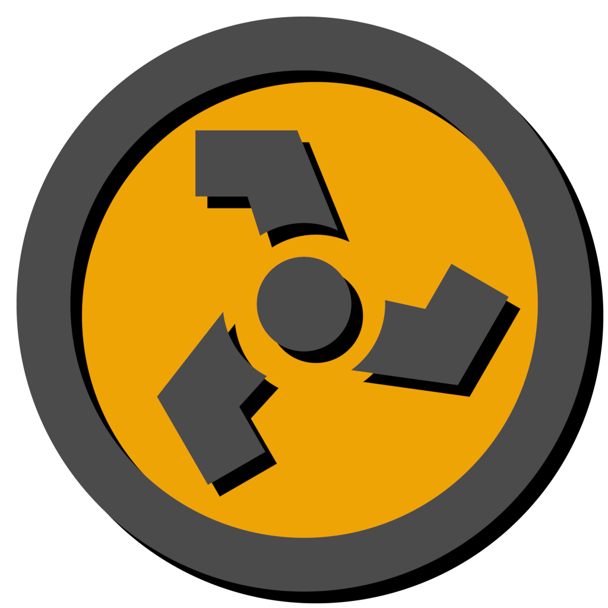
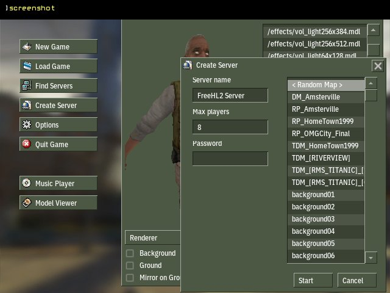
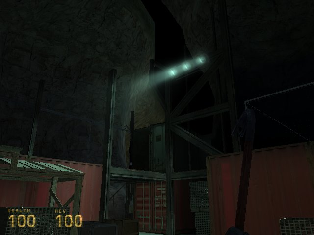
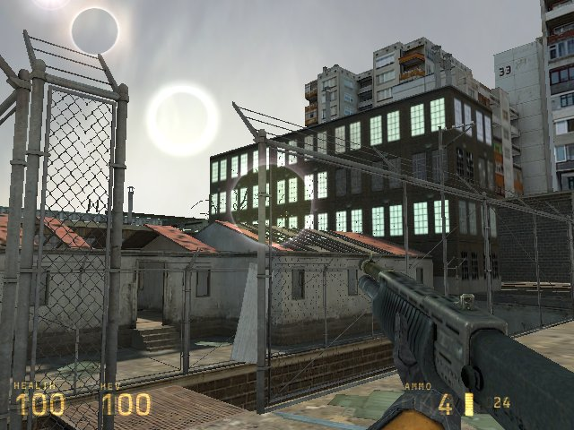
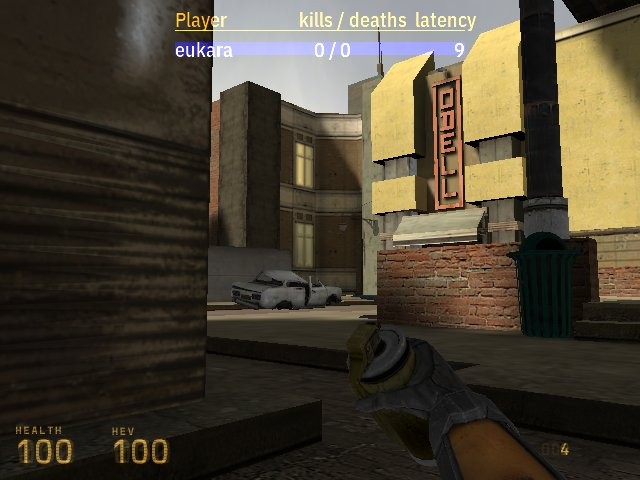

#  Rad-Therapy II

The original port of **Half-Life 2** (2004) to Quake(World).

The game is **not** playable from start to finish. *You can play deathmatch and other odd modes.*






Requires both `hl2` and `hl2dm` directories in order to function. Any copy will do fine. If you're on a case-insensitive filesystem and you're running pre .vpk data files you might want to put them in a .zip and name it 'pak0.pk3'. It's generally easier to just use the latest data from Steam.

## Playing/Installing

Run [FTE](https://www.fteqw.org/) like so:

`fteqw.exe -halflife2`

It will then automatically attempt to install **Rad-Therapy II** - when run from within your **Half-Life 2: Deathmatch** directory.

## Building
Git clone [Nuclide](https://code.idtech.space/vera/nuclide) first, run `make update` and `make fteqcc`, then clone the repository inside the Nuclide-SDK:

```
git clone https://code.idtech.space/fn/hl2 hl2
make game GAME=hl2
make plugins GAME=hl2
```

The last command will build the plugins required for the engine to load the data files. The one before it will build the game-logic.
Make sure that Nuclide-SDK has `fteqcc` and `fteqw` present for building and running, respectively.
It will also respect versions installed by the package manager, just make sure it's up to date.

## Community

### Matrix
If you're a fellow Matrix user, join the Nuclide Space. Where you can ask questions, or prod devs about what they're up to.
https://matrix.to/#/#nuclide:matrix.org

### IRC
You can also join us on #nuclide via irc.libera.chat.
It's bridged with the main room of the Matrix space.

## License
ISC License

Copyright (c) 2019-2025 Marco "eukara" Cawthorne <marco@icculus.org>

Permission to use, copy, modify, and distribute this software for any
purpose with or without fee is hereby granted, provided that the above
copyright notice and this permission notice appear in all copies.

THE SOFTWARE IS PROVIDED "AS IS" AND THE AUTHOR DISCLAIMS ALL WARRANTIES
WITH REGARD TO THIS SOFTWARE INCLUDING ALL IMPLIED WARRANTIES OF
MERCHANTABILITY AND FITNESS. IN NO EVENT SHALL THE AUTHOR BE LIABLE FOR
ANY SPECIAL, DIRECT, INDIRECT, OR CONSEQUENTIAL DAMAGES OR ANY DAMAGES
WHATSOEVER RESULTING FROM LOSS OF MIND, USE, DATA OR PROFITS, WHETHER
IN AN ACTION OF CONTRACT, NEGLIGENCE OR OTHER TORTIOUS ACTION, ARISING
OUT OF OR IN CONNECTION WITH THE USE OR PERFORMANCE OF THIS SOFTWARE.

# Content Copyright Notice

Half-Life 2 and Half-Life 2: Deathmatch belong to Valve Corporation.
Original licensed assets from Steam or a disc are required in order to experience **Rad-Therapy II**.
